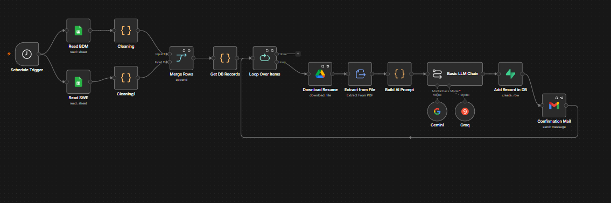
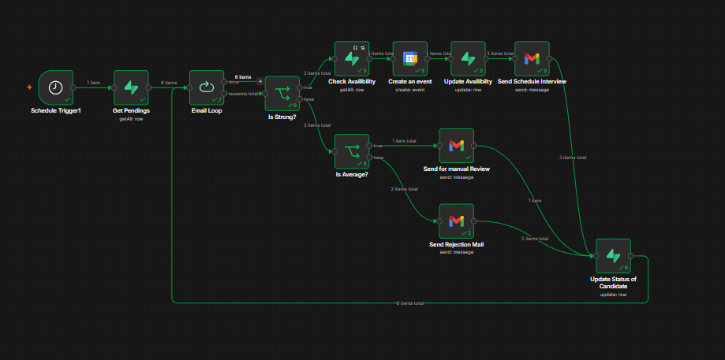
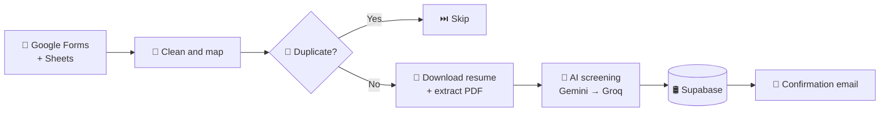
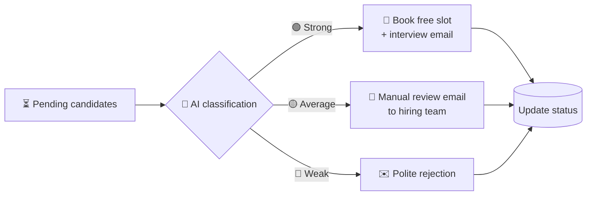

<!-- HireFlow AI · README by Usama Shahid (fewgets) -->
<div align="center">


<p>
  
  
  
  
  
</p>

</div>

---
## 📌 Overview

**HireFlow AI** is an end-to-end **recruitment automation system** built in **n8n**. It takes over the
repetitive parts of hiring (reading applications, screening resumes, sending emails and booking
interviews) so the hiring team only spends time on the candidates who matter.

Applications come in through **Google Forms**, resumes are screened by **AI (Gemini, with Groq as a
fallback)**, every decision is stored in **Supabase**, and candidates automatically get the right
email or an **interview booked on Google Calendar**.

> Currently configured for two roles: 💻 **Software Engineer** and 📈 **Business Development Manager**.

---

## 🎥 Workflows

### 🔹 Workflow 1: Candidate Ingestion and AI Screening
<p align="center"></p>

### 🔹 Workflow 2: Communication and Interview Scheduling
<p align="center"></p>

---

## ✨ Features

| | Feature |
|:-:|---|
| 📥 | Collects applications from **Google Forms and Sheets** |
| 🧹 | Normalises different role forms into **one candidate schema** |
| 🔁 | **Duplicate detection** so no candidate is processed twice |
| 📄 | Downloads resumes from **Google Drive** and extracts PDF text |
| 🤖 | **AI screening** with role-specific prompts: score, strengths, concerns |
| 🧠 | **Gemini → Groq fallback** keeps screening running if one provider fails |
| 🛢️ | Full candidate history in **Supabase PostgreSQL** |
| 📅 | **Automatic interview booking** in free calendar slots |
| 📧 | Acknowledgement, interview, review and rejection **emails** |
| 🔄 | Two **decoupled workflows** for reliability and easy debugging |

---

## 🔄 How It Works

### 🚀 Workflow 1: Ingestion and Screening *(every 2 hours)*



### 📧 Workflow 2: Communication and Scheduling *(every 12 hours)*



---

## 🗄️ Database

| Table | Stores |
|---|---|
| `candidates` | Personal info, resume link, AI score, classification, strengths and concerns, hiring status |
| `available_slots` | Interview times, booking status, assigned candidate |

The SQL is in [`database_setup/queries.txt`](database_setup/queries.txt).

---

## ⚙️ Setup

### ✅ Prerequisites
A running **n8n** instance · a Google account (Forms, Sheets, Drive, Gmail, Calendar) · a **Supabase** project · **Gemini** and **Groq** API keys.

### 1. Clone
```bash
git clone https://github.com/fewgets/Hiring-Automation.git
cd Hiring-Automation
```

### 2. Database
Open the **Supabase SQL Editor** and run `database_setup/queries.txt`. This creates `candidates` and `available_slots`.

### 3. Import the workflow
In n8n: **Workflows → Import** → `workflow/Hiring Automation.json`.

### 4. Credentials
Add these in n8n:

| Credential | Used for |
|---|---|
| Google Sheets OAuth2 | Reading applications |
| Google Drive OAuth2 | Downloading resumes |
| Google Calendar OAuth2 | Creating interview events |
| Gmail OAuth2 | Candidate emails |
| Supabase (URL + service role key) | Candidate database and slots |
| Gemini API | Primary AI screening |
| Groq API | AI fallback |

### 5. Your Google assets
Replace the Sheet IDs, Calendar ID, hiring-manager email and form-linked resources in the workflow nodes.

### 6. Test and activate
Run node by node (Sheets → Drive → AI → Supabase → Email), then switch the workflow to **Active**.

---

## 🧰 Tech Stack

| Component | Tool |
|---|---|
| Automation Engine | n8n |
| Forms and Responses | Google Forms + Google Sheets |
| Resume Storage | Google Drive |
| AI Screening | Google Gemini |
| AI Fallback | Groq (Qwen) |
| Database | Supabase PostgreSQL |
| Scheduling | Google Calendar |
| Email | Gmail API |

```text
Hiring-Automation/
├── images/              # Workflow screenshots
├── workflow/            # n8n workflow export (JSON)
├── database_setup/      # Supabase SQL
└── readme.md
```

---

## 🤝 Let's Work Together

<div align="center">

**Have an idea, a freelance project, or want to collaborate on something in AI?**
I'm always open to collaborations, freelance work and full-time opportunities.

<a href="mailto:shaikhusama541@gmail.com?subject=Collaboration%20-%20HireFlow%20AI">
  
</a>
<a href="https://www.linkedin.com/in/-usamashahid/">
  
</a>
<a href="https://github.com/fewgets">
  
</a>

<br/><br/>

⭐ **If you like this project, please give it a star. It really helps!** ⭐

<br/>

<h3>"Automating hiring so humans can focus on humans."</h3>


</div>
